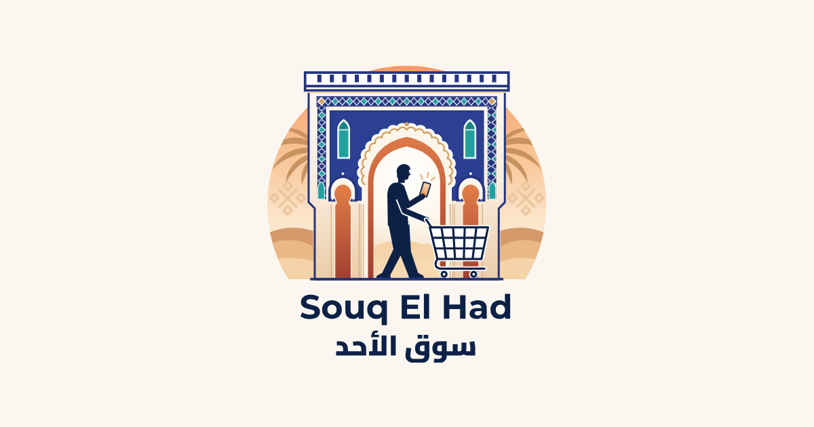
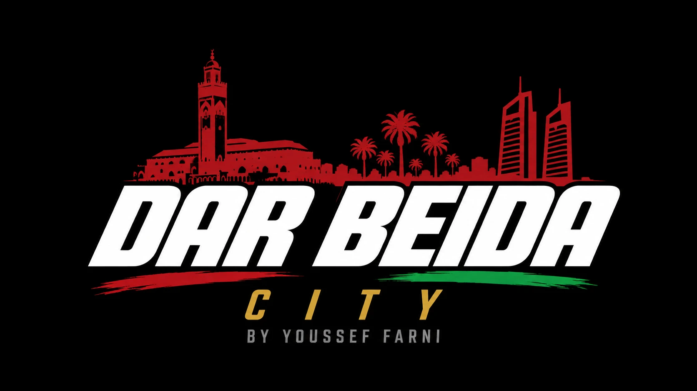

# 👋 Hey, I'm Youssef Farni

### Full-Stack Developer · Founder of Souq El Had · Creator of Dar Beida City

  
  
  
  
  

---

## 🚀 About me

- 💻 Full-stack developer based in **Morocco 🇲🇦**, working full-time since 2022
- 🧱 I build web, mobile and desktop apps with **Laravel, Next.js, React, Flutter and Node.js**
- 🤖 I use AI in my workflow: AI coding tools (Claude Code, Copilot), AI-generated UI/UX assets, and AI APIs inside my apps
- 🎮 I also make games and 3D work (Unity, Unreal Engine, Blender)
- 📚 Always learning, always shipping

---

## 🏗️ What I'm building

<table>
<tr>
<td width="50%" valign="top" align="center">

### 🛒 Souq El Had · سوق الأحد
**Founder & lead developer**

A social-commerce marketplace for Morocco. You browse products in a feed like Instagram's and order from several stores in one cart. Payment is cash on delivery, and local drivers deliver the orders.

- Product feed and Reels with videos
- Multi-store cart and checkout
- Seller and driver dashboards, chat
- Phone OTP, delivery codes, driver safeguards
- Admin panel (Filament)
- Arabic, French and English, with right-to-left support

`Next.js` `React` `TypeScript` `Tailwind` `Laravel` `MySQL` `Filament`

🌐 **Launching at [souqelhad.com](https://souqelhad.com)**

</td>
<td width="50%" valign="top" align="center">

### 🎮 Dar Beida City
**Creator & solo developer**

An open-world action game set in **Casablanca**. The streets come from real map data, and the city's landmarks are built in, including the Hassan II Mosque, the Twin Center and the Grande Poste.

- Streets generated from OpenStreetMap data
- Third-person movement, driving and vehicles
- Minimap, GPS route and world map
- 3D models of real Casablanca buildings
- Prototype made in Unity, now being moved to Unreal Engine 5

`Unreal Engine 5` `C++` `Unity` `C#` `Blender` `Python`

📺 **Devlogs coming on [YouTube](https://www.youtube.com/@youssef-farni)**

</td>
</tr>
</table>

---

## 🛠️ Tech stack

**Frontend**

**Backend**

**Mobile**

**Databases & cloud**

**Games, 3D & AI**

---

## 📂 More projects

| Project | What it is | Stack |
| --- | --- | --- |
| [Personal portfolio](https://github.com/yousseffarni/youssef-portfolio-static) | My website. English and French, an admin panel, a CV PDF that generates itself, and schema.org structured data | Next.js · Firebase · Cloudinary |
| [Club Essadaka](https://www.yousseffarni.com/en/projects/club-essadaka-app) | An app to manage a Taekwondo & Tang Soo Do school: social feed, chat and admin tools (Android, iOS, Windows) | Flutter · Firebase · Riverpod |
| [Falahatna](https://www.yousseffarni.com/en/projects/falahatna-app) | A farming advice app for Moroccan farmers, in Arabic first, that works offline | Flutter · Firebase |
| [HR Management](https://www.yousseffarni.com/en/projects/hr-management-app) | Employees, roles, leave requests and official document requests | React · Laravel · Material UI |
| [Driver app](https://www.yousseffarni.com/en/projects/driver_app) | An app for drivers that makes transport services easier to track | Flutter · Prisma · MySQL |

👉 **All projects, with screenshots: [yousseffarni.com/en/projects](https://www.yousseffarni.com/en/projects)**

---

## 💼 Experience

**Full-Stack Developer** · Casablanca, Morocco · *Dec 2022 – present*

I build new features for a business management platform (front end and back end) and work on its Flutter app for deliveries and drivers.

🎓 Bachelor's degree in Development & Administration of Computer Systems and Networks, Higher School of Technology (EST), Casablanca

---

## 📈 GitHub stats

---

## 🌍 Let's connect

I'm open to freelance work, collaborations and interesting projects. **[Get in touch on my website →](https://www.yousseffarni.com/en/contact)**

### 🚀 Always learning · Always building

